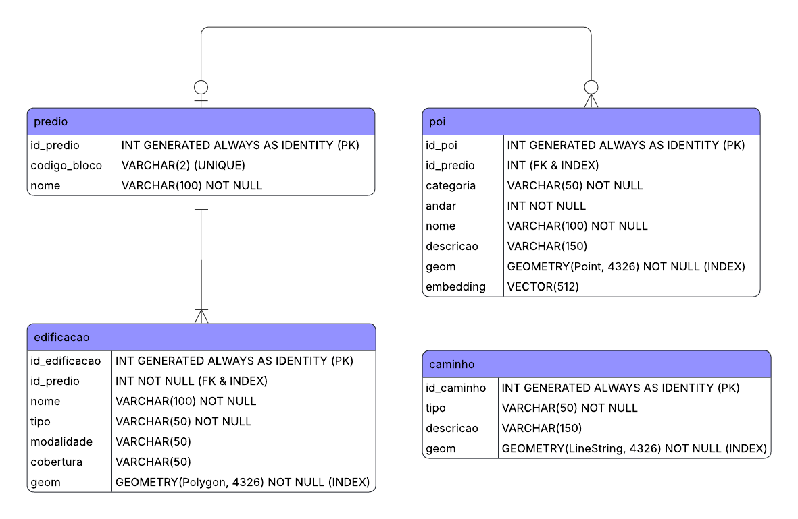

<!-- English version -->
> 🌐 *Para a versão em português desta documentação, acesse [README.en.md](README.en.md).*
<br/>

<h1 align="center"> UNANav - Smart Campus Navigation </h1>

<p align="center">
  
</p>

<br/>
<h2> ℹ️ ABOUT THE PROJECT </h2>
<p>
The UNANav project aims to provide a practical and efficient mobile application to help users navigate the entire campus of the University of Ribeirão Preto (UNAERP). The app allows users to interact with an AI using natural language or an image referencing their target location to reach their destination. Users can also manually input their origin and destination if they prefer (similar to Waze, Uber, or Google Maps). If the AI successfully identifies the user's location via GPS, it will only ask for the desired destination on campus (via natural language or an image) and inform them of their starting point. If GPS location fails, the AI will notify the user that it could not locate them on campus and prompt for both starting point and destination. The welcome screen lets users choose 1 of 4 available profiles (student, faculty, staff, and visitor) or proceed without a profile (used solely for tailored campus navigation suggestions). To ensure quick and friction-free access for anyone, the app operates without a login system. Choosing a profile tailors navigation suggestions to match the user's specific context.
</p>

<h2> 💡 UNANav TECHNICAL HIGHLIGHTS </h2>

- **Multimodal Smart Search (CLIP + pgvector):** Unified text and image search within the same vector space ($512$ dimensions). Whether typing *"library"* or submitting a photo of a building facade, the system converts the input into embeddings and executes cosine similarity queries directly inside the database.
- **Indoor Signal Degradation Handling (Geofencing + GPS):** Because mobile GPS loses accuracy inside buildings, the system uses *Geofencing* (point-in-polygon queries via PostGIS) alongside Geolocation API accuracy metrics. Upon detecting that the user is inside a building block, the app prompts for a manual starting point or a photo of the surroundings, ensuring a reliable textual "last-mile" route guidance.
- **Custom Mapping & Path Graph for UNAERP:** Due to outdated public mapping data (OpenStreetMap and Google Maps), an on-site field survey of the entire campus was conducted. This resulted in 194 mapped features (63 POIs for restrooms/water fountains with floor level and descriptions, 36 building/sports court polygons, and 88 path segments totaling ~4.5 km of connected walkable network).
- **Local-First Architecture & Privacy:** No account or login required. Personal preferences and user data (selected profile and recent navigation history) reside strictly on the device using an embedded SQLite database.

<h2> 🛠️ TECH STACK </h2>

| Layer | Technology | Role in Project |
|---|---|---|
| **Mobile App** | React Native + Expo | Cross-platform UI, photo capture, and native hardware integration. |
| **GPS & Mobile Maps** | `expo-location` + `react-native-maps` | GPS coordinate fetching and interactive map rendering via OpenStreetMap tiles (`UrlTile`). |
| **Local Storage** | SQLite (`expo-sqlite`) | On-device profile storage (Student, Faculty, Staff, Visitor) and local history ("Recents"). |
| **Back-End API** | Python + FastAPI | RESTful API managing geofencing endpoints, proximity search, and route calculation. |
| **Database** | PostgreSQL 16 | Single source of truth for campus spatial data, maps, and vector embeddings. |
| **Spatial Extension** | PostGIS 3.6.4 | Advanced geospatial queries (`ST_DWithin`, `ST_Contains`, `ST_Distance`). |
| **Vector Search** | pgvector 0.8.6 | Storage and similarity querying of text and image embeddings generated by CLIP. |
| **AI & Embeddings** | CLIP (OpenAI / OpenCLIP) | Pre-trained multimodal model converting text/photos into vector embeddings. |
| **Infrastructure / Cloud** | Oracle Cloud (OCI) + Docker Compose | Ubuntu 22.04 VM (ARM64) hosting PostgreSQL/PostGIS and the API in isolated containers. |

<h2> 🗄️ DATABASE MODELING (DB_UNANav) </h2>

The relational geospatial database was structured around the following core entities in PostgreSQL:



---

- **`tb_predio`**: Logical entity representing campus blocks/buildings (e.g., Block H, Block D, Gym).
- **`tb_edificacao`**: Physical polygons representing each building structure, sports court, or pool on the map (`GEOMETRY(Polygon, 4326)`).
- **`tb_poi`**: Specific points of interest such as restrooms and water fountains (`GEOMETRY(Point, 4326)`) featuring a vector column `embedding VECTOR(512)`.
- **`tb_caminho`**: Walkable network of the campus consisting of outdoor sidewalks and covered indoor pathways (`GEOMETRY(LineString, 4326)`).

<!--

<h2> 📁 REPOSITORY STRUCTURE </h2>

```text
Projeto-UNANav/
├── .venv/                          # Python virtual environment
├── files/                          # Project images, diagrams, and assets
│   └── unanav_logo_principal.png
├── src/                            # Primary application source code
│   ├── assets/                     # Visual assets for the mobile app
│   ├── .env                        # Environment variables (git-ignored)
│   ├── schema_unanav.sql           # PostgreSQL/PostGIS DDL schema creation script
│   ├── importar_dados_db_unanav.py # Script to load GeoJSON data into the database
│   ├── testes-de-consultas-de-rotas.sql # Validated SQL queries for geofencing and routing
│   ├── main.py                     # FastAPI API entrypoint (Back-End)
│   └── UNAERP-mapeamento-completo.geojson # Raw campus geospatial mapping
├── docker-compose.yml              # Docker Compose orchestration for PostgreSQL + PostGIS/pgvector on OCI
├── Dockerfile                      # Custom PostgreSQL 16 Docker image for ARM64 architecture
├── requirements.txt                # Python dependencies
├── README.en.md                    # English documentation of the repository
└── README.md                       # Portuguese documentation of the repository
```

<h2> 🚀 HOW TO RUN THE PROJECT </h2>

<h3> 1. Prerequisites </h3>

* Python 3.10+ installed.
* Docker & Docker Compose (for running the database).
* Node.js & Expo CLI (for running the mobile application).

<h3> 2. Database Configuration (Docker / OCI) </h3>

In the root directory where docker-compose.yml is located:

```text
Bash

# Spin up PostgreSQL database container with PostGIS and pgvector
> docker compose up -d --build

# Connect and apply the physical table schema
> psql -h localhost -p 5432 -U unanav -d unanav -f src/schema_unanav.sql

```
<h3> 3. Initial Geospatial Data Loading </h3>

In the src/ directory, with the Python virtual environment active:

```text
Bash

# Activate virtual environment (Windows PowerShell)
> .\.venv\Scripts\activate

# Install project dependencies
> pip install -r requirements.txt

# Run database population script from GeoJSON
> python src/importar_dados_db_unanav.py
```

<h3> 4. Running the Back-End (FastAPI) </h3>

```text
Bash

# Start API in development mode
> uvicorn src.main:app --reload --host 0.0.0.0 --port 8000
```

> Interactive API documentation will be available at http://localhost:8000/docs.

-->
